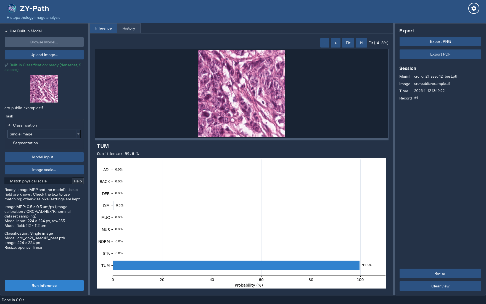
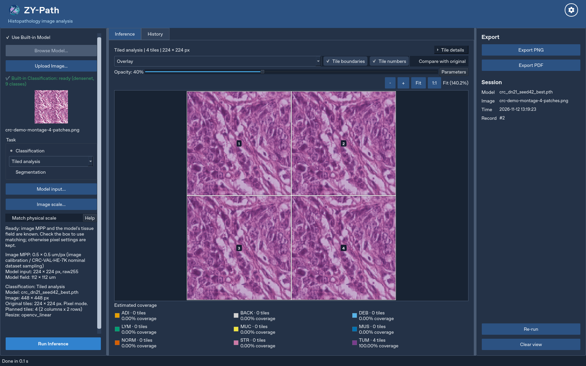
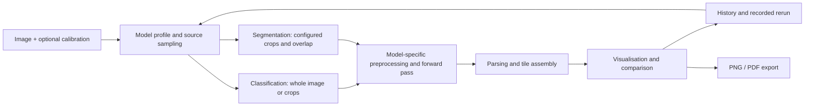

# ZY-Path

**A local desktop workbench for exploring histopathology model outputs.**
ZY-Path combines tissue classification, segmentation, image comparison,
recorded-parameter reruns and PNG/PDF reports in a Python/PyQt5 application
with CPU PyTorch inference. I built it to make analysis workflows inspectable
and investigate why predictions change with preprocessing, tissue type and scale.

**Author: Li Ziyao. Education and exploratory research only; not for clinical diagnosis.**

| Image loading | Tiled classification |
|---|---|
|  |  |

The [gallery and image provenance](docs/GALLERY.md) includes comparison and history
views, capture platform, model identity and the montage construction. Screenshots
demonstrate software behaviour, not predictive accuracy.

## My contribution and model provenance

- **Software:** I implemented the desktop application, model/input validation,
  classification tiling and crop inspection, visualisation, linked comparison,
  cancellable workers, SQLite history, recorded-parameter reruns and PNG/PDF export.
  I also implemented model input profiles, explicit calibration and regression tests.
- **Classification:** I trained the nine-class compact DenseNet classifier on
  **NCT-CRC-HE-100K**, using a supervisor-provided training script and **Sunway
  University GPU/HPC resources with Slurm**. I ran continuation and evaluation
  experiments and aligned application inputs with deterministic validation.
- **Segmentation:** my supervisor supplied the **Swin-based UPerNet checkpoint
  and reference inference notebook**. I integrated them into ZY-Path, adapting
  the supplied preprocessing, overlapping-tile/Hann-blending workflow and
  result visualisation. **I did not train the segmentation model or develop
  UPerNet/Swin.** The supervisor identified PanopTILs as its training dataset;
  its training crop/resampling details and independent scores are not established.

## Research motivation

A model that executes successfully can still confuse tissue categories. My CRC
experiments exposed difficult MUS/STR cases and a substantial difference between
internal validation and external-test performance. This motivates further work on
preprocessing reproducibility, physical image scale, domain shift and model
reliability. Segmentation consistency and interpretable visualisation are related
questions. The software supports investigating them; these research problems
have not been established as solved.

## What works

- Single-image classification and tiled analysis, with crop boxes, numbered
  tiles, class maps and estimated **tile-class coverage**.
- Segmentation overlays, class maps and **pixel-class coverage**, using a separate pipeline.
- Linked original/result views, zoom, pan, opacity and crop inspection.
- Local history, search, recorded-parameter rerun, cooperative cancellation and per-task model defaults.
- Model-specific preprocessing and optional physical-field matching when both model
  requirements and image MPP are documented. Unknown MPP is not guessed.
- Background PDF export, PNG export, Unicode paths and persistent preferences.



See the [architecture](docs/ARCHITECTURE.md) for components, workers and persistence.

## What has been evaluated

Model evaluation, software regression and deployment acceptance are separate activities.

| Evidence | Result and scope |
|---|---|
| Compact DenseNet, epoch-43 candidate | **91.267% accuracy; 0.893046 macro-F1**, 7,180 CRC-VAL-HE-7K patches. Selected by internal validation loss after training through 100 epochs. |
| Original built-in epoch-26 classifier | **90.682% accuracy; 0.885879 macro-F1**, the same external dataset. The epoch-43 candidate is a separate import, not an automatic replacement. |
| Segmentation accuracy | No Dice/IoU claim: corresponding ground-truth masks and an evaluation protocol are not available in the project evidence. |
| Native Windows regression | Archived runs include 548/548 passing at `d9fb8e5`, followed by **584 passed / 1 failed** at `fbe152a` (window-geometry timeout). A later fix exists; a new native run of the current source is required. |
| Current Linux/offscreen regression | **719 passed / 1 failed**, 0 errors/skips, at `f96a6f7`. The genuine segmentation-weight file is absent. This is not an all-pass or native-Windows result. |
| Portable Windows release | Build tooling exists. Clean-machine/offline acceptance and a formal release are **not established**. |

Classification figures come from supplied HPC evaluation logs and prediction CSVs;
their arithmetic, class counts and checkpoint identities were independently checked.
This update does not claim fresh re-inference of the original test images. The
candidate improves aggregate scores but not every class: MUS F1 is 71.60%, STR
recall is 62.71%, and some other measures decrease. The
[evaluation record](docs/MODEL_EVALUATION.md) gives hashes, per-class results,
confusion matrices, preprocessing and limitations. These scores do not describe
arbitrary uploads.

An ImageNet-pretrained **DenseNet169 comparison is being fine-tuned**; no independent
CRC test score is claimed for it. It uses its own ImageNet input normalisation.
See [testing](docs/TESTING.md) for dated software results, including failures.

## Run from source

Use 64-bit **Python 3.10 on Windows 10/11**. From the checkout in PowerShell:

```powershell
py -3.10 -m venv .venv
& .\.venv\Scripts\python.exe -m pip install -r requirements.txt
& .\.venv\Scripts\python.exe main.py
```

Use an existing environment's Python if it is already configured. Model weights
and datasets are **not included**. Genuine built-in resources belong at:

```text
models/
  crc_dn21_seed42_best.pth
  UPerNet_TME_tissue-panoptils_best_model_100ep.pth
```

UPerNet also requires its locally cached configuration. The application reports
missing resources; obtain models only with appropriate permission. Trusted compatible
custom models can be imported with their own labels and input profiles. See
[models](docs/MODELS.md), [input profiles](docs/INPUT_PROFILES.md) and the
[user guide](docs/USER_GUIDE.md). Complete tests also need the documented genuine
training-script resource; missing resources remain failures or collection errors.

```powershell
& .\.venv\Scripts\python.exe -m pytest -ra --tb=long --color=no
```

## Project status and limitations

This is a **research/educational prototype**, not a clinically validated product
or an accepted Windows 1.0 release. Classification was developed for nine colorectal
tissue categories. Staining, acquisition, scale and tissue domain can change
predictions. A softmax score is not a calibrated probability of correctness.
The internal 80,002/19,998 split is at **patch level**, not verified patient level.
Whole-slide clinical validation has not been established. The optional
[ROI tool](docs/CALIBRATED_ROI.md) prepares calibrated regions; it does not add
whole-slide inference to the desktop application.

| Further documentation | Contents |
|---|---|
| [CRC dataset](docs/CRC_DATASET.md) | Source, classes, counts, staining and scale |
| [Model evaluation](docs/MODEL_EVALUATION.md) | Traceable external CRC results and limitations |
| [Windows release](docs/WINDOWS_RELEASE.md) | Build requirements and actual acceptance status |
| [Licensing and attribution](docs/LICENSING.md) | Source, models, datasets, dependencies and font permissions |
| [Portfolio audit](docs/PORTFOLIO_AUDIT.md) | Scope, evidence gaps and suggested repository metadata |

History/results use `%APPDATA%/ZY-Path`; preferences use QSettings. Logs can contain
local paths and should be reviewed before sharing. No blanket source/model/data
licence has been added; third-party licences remain applicable.
Contact: **ziyao604502@gmail.com**.
