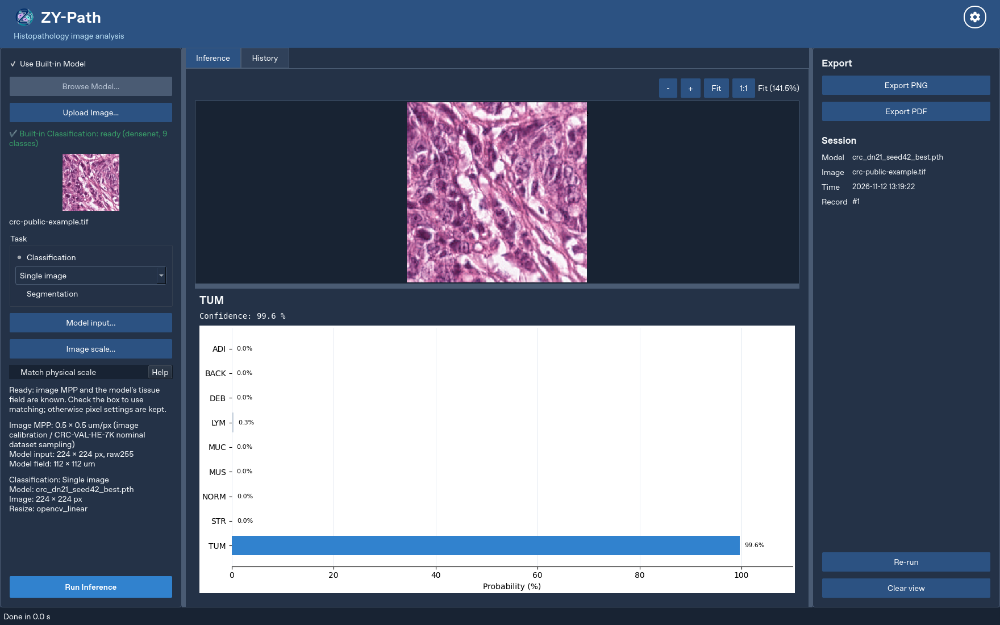
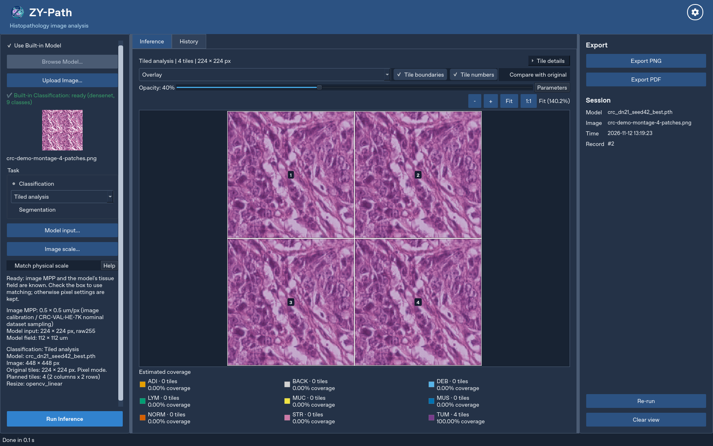
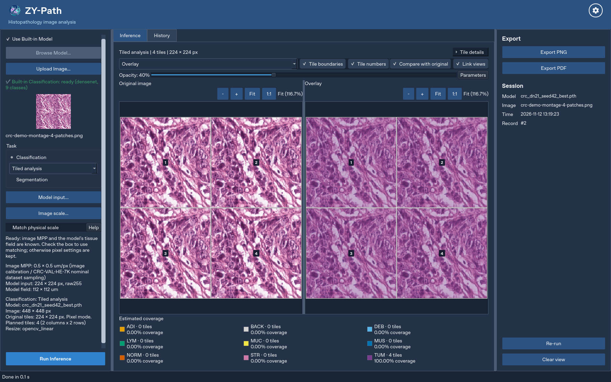
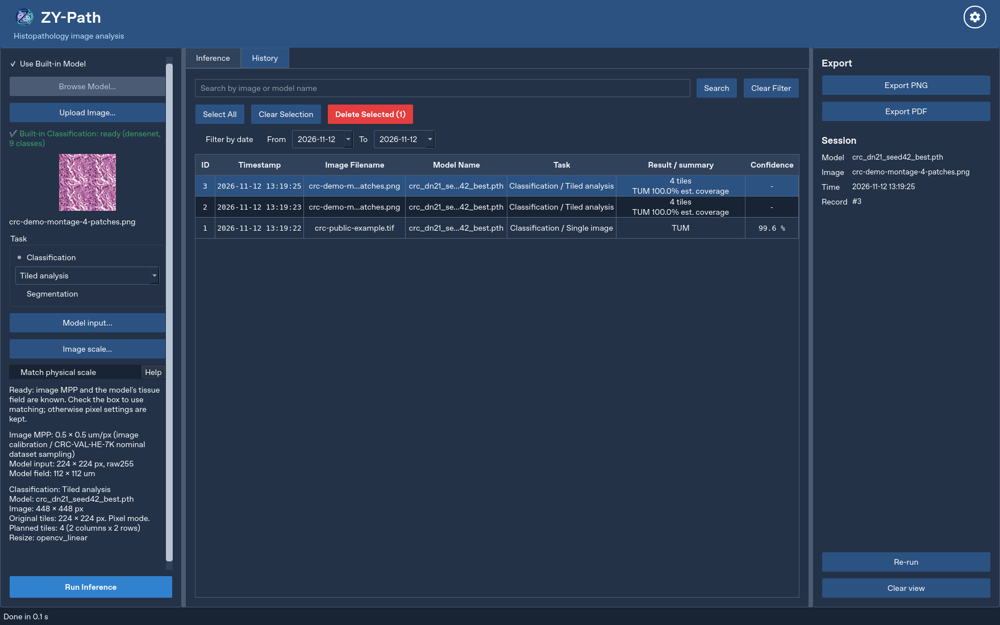

# Application gallery and image provenance

These are genuine application captures using the real built-in compact DenseNet
checkpoint and normal background inference workers. No predictions or result
widgets were injected. Captures use Linux/Qt offscreen on a virtual 1920 x 1200
canvas, with a 1760 x 1100 application window. They are not native-Windows or
packaged-release acceptance evidence.

## Single-image classification

One public CRC patch, displayed as `crc-public-example.tif`. The displayed
confidence is a model output, not dataset accuracy or calibrated reliability.

## Classification tiles

The input is an **artificial 2 x 2 montage of four unresized copies of the same
224 x 224 patch**, yielding 448 x 448 pixels. It is not a contiguous tissue ROI
or four independent test examples. Each source tile is 224 x 224 and is actually
classified. The 100% displayed TUM coverage concerns four predicted tile classes;
it is not a model-accuracy result or a pixel segmentation measurement.

## Linked comparison

The same classification run, with original/result comparison, numbered crops
and linked source coordinates enabled.

## History and recorded rerun

Three actual records: one single-image run, one four-tile run and its recorded
rerun. PDF export was also executed during capture; its local output is not
distributed because it includes local runtime paths.

## Attribution and capture identity

- Source patch: `TUM-TCGA-AAHIDTWA.tif`, supplied from **CRC-VAL-HE-7K**.
- Dataset authors: Jakob Nikolas Kather, Niels Halama and Alexander Marx (2018),
  [Zenodo v0.1, DOI 10.5281/zenodo.1214456](https://doi.org/10.5281/zenodo.1214456).
  Dataset/image terms are separate from this application's source licence.
- The TIFF was renamed for display. The montage repeats the original decoded
  pixels without spatial resizing. Dataset nominal 0.5 MPP is explicitly
  attributed; no MPP was inferred from cell appearance or print DPI.
- Model: original built-in epoch-26 compact DenseNet,
  SHA-256 `8f89bd825641fba276066b54432b5d73a62b11ed6c0d70bb94c9f0bc7e2fe325`.
- Application code: `b4ba6346300b51aab8e6056d9cc0c1e25324bd55`.
  This portfolio update does not change application inference code.
- [Capture manifest](images/provenance.json) contains the source-image and screenshot
  checksums. No raw dataset or weights are committed. Visible filenames are generic;
  there are no private local paths, account names or patient details in these captures.

## Segmentation illustration

A public segmentation capture is **not included yet**. The genuine supervisor
checkpoint is absent from the capture environment, and the public-display
permissions/source of the previously supplied breast-image example are not
documented here. A synthetic segmentation fixture is not substituted for a genuine
model result. A real, appropriately attributed and publicly shareable capture can
be added separately; the [model documentation](MODELS.md) describes the existing pipeline.
